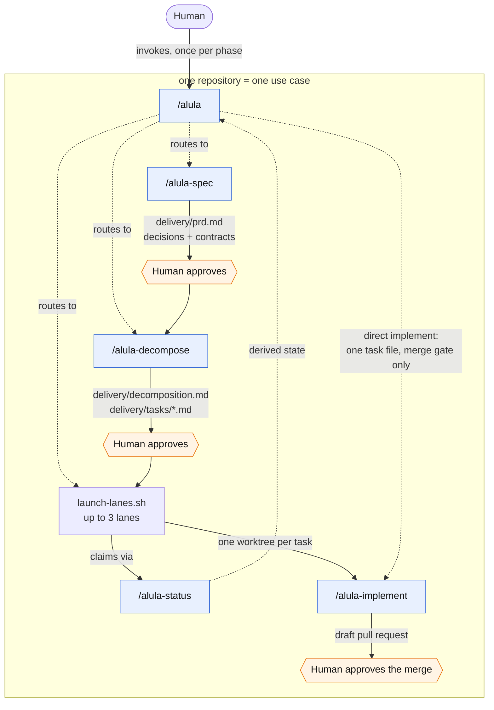
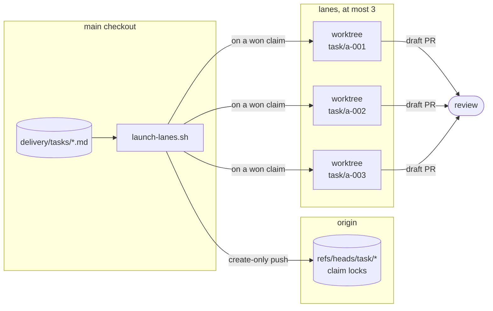
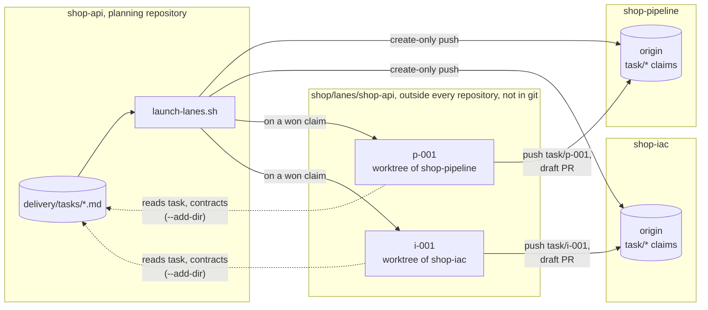

# Alula

Agent Skills for AI-native delivery: requirements and design spine,
decomposition, parallel implementation lanes, review.

*Boring on purpose.* The name is Latin for "little wing": the alula is the small
feather group that keeps a bird's wing from stalling at low speed. Alula is the
same kind of part for delivery, small and unglamorous, and there to keep parallel
work from stalling. The reasoning is in
[ADR-010](docs/decisions/ADR-010-alula-name.md).

**This repository is the kit.** The five Alula skills are one workflow,
not a catalogue you pick from. Each phase consumes the file the previous phase
wrote, so a single skill installed alone is a phase with no input and no
consumer. Install them together.

The skills hold no harness-specific tool names. The lane launcher has adapters
for Claude Code, GitHub Copilot CLI, Codex CLI, OpenCode and Pi, and a custom
command for any other, so no single vendor's license is required. A task says how much capability it needs
with a [tier](.agents/skills/alula/references/conventions.md#tiers), and the
harness, or your own mapping, decides which model that means.

## How the kit fits together

A repository is one **use case**: one project, one team, one set of
requirements. Decomposition cuts it into **epics**, coherent slices one person
can hold in their head, and each epic into **tasks**, each one branch, one lane
and one pull request.

| Unit | Written as |
|---|---|
| Use case | `delivery/prd.md`, with its decision records and `delivery/contracts/` |
| Epic | a section of `delivery/decomposition.md` |
| Task | `delivery/tasks/<id>.md` |

Every artifact lives under `delivery/` at the repository root, so no agent has
to search for one.

The definitions the agents apply are in
[delivery conventions](.agents/skills/alula/references/conventions.md#use-cases-epics-and-tasks).



Solid arrows are **artifacts**. Dotted arrows are **delegation**. Every phase
transition happens through a file, never through a live session, so a phase can
start in a fresh context and no long-running session has to carry state.

### Two ways through

The orchestrator investigates the request and the code before choosing how much
of the route to use:

| Path | When | What runs |
|---|---|---|
| Direct implement | One well-understood change with obvious acceptance criteria | one task file, then `alula-implement` in the ordinary checkout; no claim, no worktree, only the merge gate |
| Full route | Several tasks, contracts to keep parallel work consistent, or a decision worth recording | every phase and every gate, up to three lanes at once |

How much of a full route runs in parallel is decomposition's finding, not a
choice made up front; see [Parallel or serial](#parallel-or-serial).

## The five skills

| Skill | Owns | Produces | Runs as |
|---|---|---|---|
| `alula` | Where the project stands, the route, the gates, the lane policy | decisions about what happens next | a human's session |
| `alula-spec` | Requirements (stage A), then decisions and contracts (stage B) | `delivery/prd.md`, decision records, `delivery/contracts/` | a human's session |
| `alula-decompose` | Splitting approved work into epics and independent tasks | `delivery/decomposition.md` and `delivery/tasks/<id>.md`, validated | a human's session |
| `alula-status` | Claims and run state, read from git | exit codes and tab-separated rows | `sh`, no model |
| `alula-implement` | One task into one validated change | a working tree and a handoff report | an unattended lane |

Only `alula` is invoked by a human directly. The rest are reached
through it, or through `launch-lanes.sh`.

`alula-spec` covers two stages rather than shipping as two skills: they are
written in one sitting from the same source material, and the design spine is
worthless without approved requirements to hang it on.

Review is deliberately **not** shipped: use the harness's own review capability,
or install a review skill alongside the kit and compare it against the
unassisted harness before adopting it. To have the orchestrator suggest which
review skill a pull request needs, map concerns such as security or data to
installed skills in `delivery/review-lenses.conf`; the format is in the
[review lenses](.agents/skills/alula/references/conventions.md#review-lenses)
convention.

## Where the work happens



A claim is a create-only push of `task/<id>`: the first push wins, the loser is
told who holds it and picks another task. Nothing stores status; it is derived
from git refs and pull request state on every read.

The lane cap is three because three is roughly what one person can review, not
what the machine can run.

Each lane's worktree goes in `../lanes/<repository>/<task-id>`, beside the
checkout the launcher runs from, where `<repository>` is that checkout's
directory name. The extra level matters because task ids repeat from one use
case to the next: two repositories cloned side by side would otherwise both put
their `a-001` in `../lanes/a-001`. Nothing under `lanes/` is tracked by git:
each directory is a `git worktree` registered with its own clone, holding that
clone's task branch.

To put lanes somewhere else, set `ALULA_WORKTREE_ROOT` to a directory. It
replaces the whole default: task ids go directly under it, with no repository
level added, so give each use case its own directory and never share one between
two use cases. Where lanes live is each developer's choice rather than the
project's, so set it in your own environment for the planning repository, not
in a committed file. With mise, that is the untracked `mise.local.toml` at the
planning repository's root:

```toml
[env]
ALULA_WORKTREE_ROOT = "{{ env.HOME }}/lanes/shop"
```

Every launch then uses it: `a-001` runs in `~/lanes/shop/a-001`, whether you
start the launcher yourself, the follow loop starts it, or the orchestrator
does. `direnv` or an `export` in your shell work the same way. For a single
launch, `--worktree-root <dir>` takes precedence over the variable.

### Parallel or serial

Not every task set parallelizes. Two tasks editing the same file cannot be
merged independently however independent they look, and on an existing codebase
work converges on existing files far more often than new work does. Expect a
serial set there; it is the normal case, not a degraded one.

Decomposition finds this out and records it in the task files, so nobody has to
remember it at launch time:

- `conflicts_with` names the tasks one task must never run beside
- `parallel: false` makes a task run alone: it starts only when nothing else of
  the set is in flight, on anyone's machine, and nothing starts while it runs.
  Use it for a lockfile change, a migration, or a rename across the repository,
  where the shared ground is too wide to list
- a set that serializes marks every task `parallel: false`, and says **Run as:**
  serially in `delivery/decomposition.md`; the validator refuses the two
  disagreeing

The launcher and the "what's next" answer both read those fields, so a serial
set runs one lane at a time with no flag to pass. Run the launcher again after
each merge to start the next task.

A serial set still goes through every phase and every gate: the requirements,
contracts and task files are what stop the work encoding guesses, whether or
not it runs concurrently. What changes is who needs the lanes. When one person
holds the whole set, skip the launcher and invoke `alula-implement` per task
in dependency order; the claim only earns its keep when several people pick
from the same tasks.

### Which model runs a lane

Each task's `tier` says how much capability its work needs:

| Tier | For |
|---|---|
| `plan` | Design decisions, contracts, a task with interacting constraints |
| `build` | Ordinary execution against explicit acceptance criteria. The default |
| `chore` | Mechanical changes with no judgement in them |

A tier is a hint, not a model name. Alula cannot know which models your
account may use, so by default it passes no model at all and the harness applies
its own default. To say what a tier means for you, write a `tiers.conf` at
`~/.config/alula/tiers.conf`. The names below are examples:

```ini
[plan]
    harness = claude
    model = opus

[build]
    model = sonnet

[chore]
    harness = copilot
    model = gpt-6-luna
```

The file uses git's own config format, so comments and quoting work as they do
in `.gitconfig`. Harness and model are both optional. A mapping applies only to
the harness it names, so a model id never reaches a harness that would refuse
it. A team that agrees on a mapping can commit it as `delivery/tiers.conf`; the
developer's own file wins, tier by tier. The full rules are in the
[conventions](.agents/skills/alula/references/conventions.md#mapping-a-tier-to-a-model).

A lane runs on the first of: `--harness`, the harness its tier maps to,
`$ALULA_HARNESS`, then the first harness found installed. `--harness` moves a
whole launch on purpose, for example to the one whose allowance still has room.

### Harnesses

| Harness | Name | Status |
|---|---|---|
| Claude Code | `claude` | Validated |
| GitHub Copilot CLI | `copilot` | Validated |
| Codex CLI | `codex` | Adapter only |
| OpenCode | `opencode` | Adapter only |
| Pi | `pi` | Adapter only |
| Anything else | `custom` | Your command |

*Validated* means a lane ran on the real CLI and the result is recorded in
[harness validation](docs/harness-validation.md). *Adapter only* means the
command line follows the harness's documentation and a test proves the launcher
passes it, but nobody has run a real lane there yet. If you have the license,
running the checks and sending the result is the most useful contribution you
can make.

Safety is not the same on every harness. Claude Code and Copilot CLI deny
`terraform apply` and `terraform destroy`; OpenCode denies them through the
permission config the launcher passes; Codex relies on its sandbox, which writes
inside the worktree and has no network; **Pi has no permission system**, so run
its lanes in a container or a throwaway machine. `--no-web` is honoured by all
five.

For a harness without an adapter, set `ALULA_LANE_CMD` and `--harness custom`
(or `ALULA_HARNESS=custom`). The template is a shell command line, run in the
lane's worktree, and these placeholders become the lane's values:

| Placeholder | Value |
|---|---|
| `{prompt}` | What the session is told to do |
| `{model}` | The model the tier maps to, empty when there is none |
| `{worktree}` | The lane's worktree, also the current directory |
| `{plan_dir}` | The checkout that holds the planning files |

```sh
export ALULA_LANE_CMD='mycli run --model {model} --dir {worktree} {prompt}'
```

Placeholders are values, never pasted text, so quotes and `$(...)` in a path or
prompt do nothing. The command's exit status decides the rest: zero publishes a
draft pull request, non-zero gives the claim back if the lane left no work.

Putting every task on `plan` is how a budget disappears, so review the tiers when
you approve a decomposition.

Model ids change with releases, and an account's plan decides which ones it may
use. A harness refuses an id it cannot use before any request, which costs
nothing, so check an id before it goes into a mapping. For Copilot CLI:

```sh
copilot -p "Reply OK." --model <id>
```

### Several repositories

A use case usually spans several repositories: infrastructure as code, a
service, a data pipeline, sometimes an API and a demo app. The kit plans it
**once, in one of them**, and lands each task in the repository its change
belongs to. Nothing is copied between repositories, so there's nothing to keep
in sync by hand.

Clone every repository of the use case side by side, in one directory named
after the use case, each clone named after its repository:

```text
shop/                         one directory per use case
├── shop-api/                 planning repository: delivery/, and the kit
├── shop-pipeline/
├── shop-iac/
└── lanes/
    └── shop-api/             named after the planning repository, where the launcher runs
        ├── p-001/            worktree of shop-pipeline, branch task/p-001
        └── i-001/            worktree of shop-iac, branch task/i-001
```

`lanes/` sits beside the clones, not inside any of them, and holds one
directory per use case, not one per repository: every worktree goes under the
planning repository's name, whichever repository it belongs to. What reaches
the forge is the lane's branch, pushed to its own repository.



The plan is read in one place, and every lane runs in one place; claims,
branches and pull requests happen in the repository each task changes.

- **The planning repository** holds `delivery/` (requirements, decisions,
  contracts, task files) and is the only one the kit is installed in. Pick the
  repository whose lifecycle is the use case's, usually the main code
  repository. When three or more repositories share the work evenly, a small
  dedicated `<use-case>-hub` repository keeps any one of them from becoming
  special.
- **A task names where it lands** with `repo: shop-iac`, the directory name
  of the clone. Its claim, branch, worktree and pull request are all in that
  repository; its task file stays in the planning one. A task without `repo`
  lands in the planning repository, so a single-repository use case changes
  nothing.
- **Dependencies cross repositories.** A task in the pipeline repository can
  wait for the API contract task to merge; `status.sh` reads every repository
  the task set names and derives state from each one's branches and pull
  requests.
- **Decisions** about the use case live in the planning repository. A decision
  confined to one repository's internals lives in that repository's own record.
- **Contracts** are planned in `delivery/contracts/`. Once built, the
  repository that produces an interface owns its as-built form (an OpenAPI
  document, a schema, a published package), and consumers pin a version of it.
  This is how a service consumes a shared library: it pins a published version.

Run every kit command from the planning repository. The validator checks that
each `repo` has a clone beside it, so a missing clone fails at decomposition,
not hours later when a lane starts on someone else's machine. Each lane runs in
its target repository with read access to the planning repository
(`--add-dir`), where it finds its task file, the contracts and the decisions.

Every developer needs the same layout. A missing clone makes `status.sh` stop
and name it, rather than guess at the state of that repository's tasks.

## Getting started

Each developer machine needs `git`, a POSIX `sh`, and `gh` 2.0 or later,
authenticated with `gh auth login` against the repository's forge. `gh` is not
optional: task branches are deleted on merge, so merged pull requests are the
only record of which tasks are done, and `status.sh` refuses to run without
them.

The helpers are POSIX `sh` and POSIX `awk`, so nothing else is installed: they
run on the `sh` of Linux, macOS and Alpine as they come, and CI runs them on
dash, BusyBox ash and macOS's own `sh`.

### 1. Install the kit into a target repository

Use the `skills` CLI. It installs all five skills, writes each one to
`.agents/skills/` and symlinks it into `.claude/skills/`, and records a
`skills-lock.json` so every developer restores the same version.

```sh
npx skills add https://github.com/ancelin-code/alula.git \
  --skill '*' -a claude-code -a github-copilot -y
```

Add an `-a <agent>` for each other harness your team uses; `npx skills add
--help` lists the names it knows.

Then commit what it produced, including `skills-lock.json` and the symlinks. Git
stores symlinks natively, so **lanes running in worktrees get the kit without a
second install**. Everyone else restores the pinned versions with:

```sh
npx skills experimental_install
```

Scope the agents with `-a`. Plain `--all` also writes a full third copy under
`agent/` for the other agents it supports, which a target repository does not
need.

Then make the kit the project's default assistant, and commit `AGENTS.md`:

```sh
sh .agents/skills/alula/scripts/install-routing.sh
```

It appends a short block to `AGENTS.md`, creating it if needed, that sends every
request about the project to `alula`. Claude Code and Copilot
CLI both read that file on every request, so the kit is consulted even when a
question matches no skill description. Without it, a plain *"what's the status
of this project?"* reached no kit skill in either harness, and Copilot answered
from git alone, recommending a task already merged; see
[harness validation](docs/harness-validation.md#5-routing-plain-questions-to-the-kit).
The orchestrator runs the same step itself the first time it finds the block
missing.

The same script writes a starter `delivery/review-lenses.conf`, which is
worth committing too. When a task reaches review, the orchestrator reads this
file to suggest which review skill to run on its pull request. As shipped, it
suggests only the harness's own review. Edit it to map a concern to a review
skill installed in the project, optionally with the paths that bring that
concern in:

```text
# lens     skill             paths that bring the lens in
general    code-review
security   security-review   */auth/* *secret* *.tf
```

A task can also ask for a lens through its `review` field, and anyone can add
one to a pull request with a `review:<lens>` label. The full format is in the
[review lenses](.agents/skills/alula/references/conventions.md#review-lenses)
convention. The script never overwrites an existing file.

Both directories matter: Copilot CLI reads `.agents/skills/`, while Claude Code
reads `.claude/skills/` and will not fall back. Installing by hand into only
`.agents/skills/` silently degrades every Claude Code lane; see
[harness validation](docs/harness-validation.md).

### 2. Check for shadowing skills

Slash invocation makes skill names part of the interface, so a personal skill of
the same name wins. On each developer machine:

```sh
copilot skill list          # inspect Personal skills
ls ~/.claude/skills         # and here
```

Disable anything that collides with a `alula` name.

### 3. Drive the route

Tell the orchestrator what you want built:

```text
/alula <what to build>
```

In a repository with no `delivery/prd.md` yet, that starts the requirements.
Once the file exists, the same request revises it, and decomposition turns the
new work into new epics. The repository is the use case, so there is never a
second one to start.

Ask it where things stand at any time, in your own words: *"what's next?"*,
*"what's the status?"*, *"who is on what?"*. The answer comes from
`alula/scripts/where.sh`, which reads `delivery/` and git in one
call and names the next action. For each pull request in review, it also
names the review skills to run on it.

Each invocation routes one phase, which ends by writing its artifact under
`delivery/` and stopping. Approve that artifact, then invoke the orchestrator
again for the next phase: it keeps nothing between them and re-reads where you
are from `delivery/`, so no session has to stay alive across a gate.

To start lanes once tasks are approved:

```sh
sh .agents/skills/alula-status/scripts/status.sh --ready \
  | awk '$1=="TASK"{print $2}' \
  | sh .agents/skills/alula/scripts/launch-lanes.sh --dry-run
```

Drop `--dry-run` to start real lanes. Each lane ends as a draft pull request:
once its session exits cleanly, `publish-lane.sh` commits the change, pushes it,
and opens the pull request with the lane's handoff report, written in the
repository's pull request template when it has one. A lane that stopped on a bad
task reverts its attempt and publishes nothing. A lane whose session failed
before doing anything, on an expired login for example, gives its claim back by
itself. Tasks marked `parallel: false` are held back until they can run alone,
so re-run the launcher after each merge.

> **Security: lanes have web access by default.** A lane can fetch pages and
> search the web, which helps it read a library's documentation, and it is a
> prompt-injection path: the lane runs unattended with a shell and your git
> credentials, and a fetched page is text the model may act on. Pass `--no-web`
> to the launcher when lanes should build from the repository and its contracts
> alone, for example on a codebase with secrets in reach. It removes the web
> tools on both harnesses; the shell can still reach the network, so it narrows
> the path rather than closing it.

Then let the set run itself. The follow loop launches each task as the merges
it depends on land, and prints one line per event, so nobody has to ask what is
next or refresh the forge:

```sh
sh .agents/skills/alula/scripts/follow.sh -- --no-web
```

Options after `--` go to the launcher. Your part is reviewing and merging the
pull requests it reports; it never merges, and it exits once every task is
merged, or when the remaining tasks can never become ready. The orchestrator
starts it for you after the first launch.

### 4. Watch a running lane

Lanes run detached, one process per task, with no terminal attached. Each writes
everything it does to `.lanes/logs/<task-id>.log` under the main checkout
(`--log-dir` moves it).

```sh
tail -f .lanes/logs/a-001.log          # follow one lane
tail -n 40 .lanes/logs/*.log           # where each lane got to
pgrep -af 'claude -p|copilot -p'       # which lanes are still alive
```

The worktree is the other live view. The commands below name it once, from the
planning repository, wherever the launcher put it:

```sh
home=$PWD
lane=${ALULA_WORKTREE_ROOT:-../lanes/$(basename "$home")}/a-001
git -C "$lane" status                  # what the lane has changed
git -C "$lane" log --oneline           # what it has committed
```

That is usually a faster answer than reading its log.

To stop a lane, kill its process, then remove the worktree and the claim:

```sh
pkill -f 'tasks/a-001\.md'          # a lane is known by its task file
git worktree remove --force "$lane"
git push origin --delete task/a-001
```

Deleting the remote branch is what releases the claim. Skip it and the task
stays held by you and nobody else can pick it up.

A lane whose task names a `repo` belongs to that clone, not to the planning
repository: its worktree is registered there, and its claim is on that
repository's origin. Run the last two commands against the clone, for
`repo: shop-iac`:

```sh
git -C ../shop-iac worktree remove --force "$lane"
git -C ../shop-iac push origin --delete task/a-001
```

### 5. Pick a lane back up by hand

You cannot type into a running lane: `-p` sessions have no input attached. What
you can do is resume the conversation once it has finished or stopped, in the
same worktree, with its context intact.

Copilot lanes print the command to do it as their last line, so it is already in
the log:

```sh
grep -h 'copilot --resume' .lanes/logs/a-001.log
cd "$lane" && copilot --resume=<session-id>
```

Claude lanes do not print a session id in text mode, so there is nothing in the
log to resume from. Use `claude --continue` from inside the lane worktree, which
picks up the most recent session for that directory:

```sh
cd "$lane" && claude --continue
```

That is reliable only while the lane is the last session started in that
worktree. When it is not, start a fresh session there and point it at the task
file and the branch:

```sh
cd "$lane" && claude "/alula-implement $home/delivery/tasks/a-001.md"
```

Claude Code can also run lanes as attachable background sessions
(`claude --bg`, then `claude attach <id>`), which would remove this asymmetry on
the Claude side. The launcher does not use it: Copilot CLI has no equivalent, the
logs come back as raw terminal output, and a background session waits for input
instead of exiting, so a stuck lane would hold its claim indefinitely. See
[docs/harness-validation.md](docs/harness-validation.md) before changing this -
slash-command invocation was proven for `-p` and would need re-proving.

## Plug a connector

Git stays the only place where work is decided. Other tools, a Jira board for
management or Confluence pages for readers who never open the forge, get a
one-way copy of it: a **connector** reads the kit's state and makes the tool
match it. Connectors live in their own repositories, with their own credentials
and configuration, so the kit holds nothing tool-specific.

The kit's side is one command. From the planning repository, it prints the
whole use case as JSON: epics and what each delivers, tasks with the state
`status.sh` gives them, their repository and pull request, and the planning
documents.

```sh
sh .agents/skills/alula-status/scripts/snapshot.sh
```

A connector reads that on stdin:

```sh
sh .agents/skills/alula-status/scripts/snapshot.sh \
  | alula-jira --config ~/jira/shop.toml --dry-run
```

Each run compares the whole snapshot with the tool and applies the difference,
so it can run by hand, after each merge, or from a scheduled job, with the same
result. If the state cannot be derived, `snapshot.sh` prints nothing and exits
non-zero, so no connector acts on a guess.

| Connector | Tool | Repository |
|---|---|---|
| `alula-jira` | Jira Data Center | `alula-connector-jira` (not published yet) |

What a connector must and must not do is the contract in
[ADR-005](docs/decisions/ADR-005-external-tool-connectors.md). In short:

- **One way only.** It writes to the tool and never to git.
- **Declared ownership.** It names the fields it owns and writes only those.
  In Jira, sprints, points, priority and assignee stay with people, and an issue
  moved into a sprint stays there.
- **Visible corrections.** A change to an owned field, such as a card dragged to
  another column, is put back on the next run, with a comment saying why.
- **Standard output.** `--dry-run` prints each change without making it. Exit
  `0` means the tool matches, `1` means a change failed, and `2` means the
  input or configuration was refused before anything was touched.

To write a connector for another tool, start from that contract and the
snapshot's `schema` number, and refuse any schema version the connector doesn't
know.

## Develop

```sh
mise run dev     # local environment and git hooks
mise run lint    # ruff, shellcheck, rumdl, actionlint, Vale, skillcheck, security scan
mise run test    # behavioural tests
```

## Maintenance

Every rule in this kit that works around harness behaviour was earned by a test,
and harness behaviour changes. The tests, and the CLI versions they were run
against, are recorded in [docs/harness-validation.md](docs/harness-validation.md).

Re-run them after a Claude Code or Copilot CLI upgrade, and delete any rule that
no longer earns its tokens. Both CLIs update themselves silently, so nothing
announces the moment to do this: compare the recorded versions against
`claude --version` and `copilot --version` before a run that matters.

Two rules are worth re-checking first, because both fail quietly rather than
loudly:

- the `.claude/skills/` symlinks, which exist only because Claude Code did not
  register `.agents/skills/`. Harmless if that changes, but dead weight.
- slash-command invocation of a skill. If a harness stops resolving
  `/alula-implement <task-file>` as an invocation, every lane reverts to
  reading the skill as prose, which makes its boundaries advisory and leaves no
  trace in the lane log.

This is a maintainer's task, not part of a run. It is deliberately not in any
`SKILL.md`, so no agent pays tokens for it on every invocation.

## Design

The route, the gates and the lane policy live in the `alula`
skill. Shared conventions - the use case, epic and task units, placeholders,
task schema, branch names, the claim protocol, tiers, pull request rules -
are in its `references/`, loaded on demand during a run.

Everything an agent does not need at run time stays out of the skills and lives
in `docs/`: the record of which harness assumptions were tested and what the
tests found, and `docs/decisions/` for the choices whose reasons are not
recoverable from the code. Skills carry rules; `docs/` carries the evidence for
them.

## License

Apache-2.0. See [LICENSE](LICENSE).
