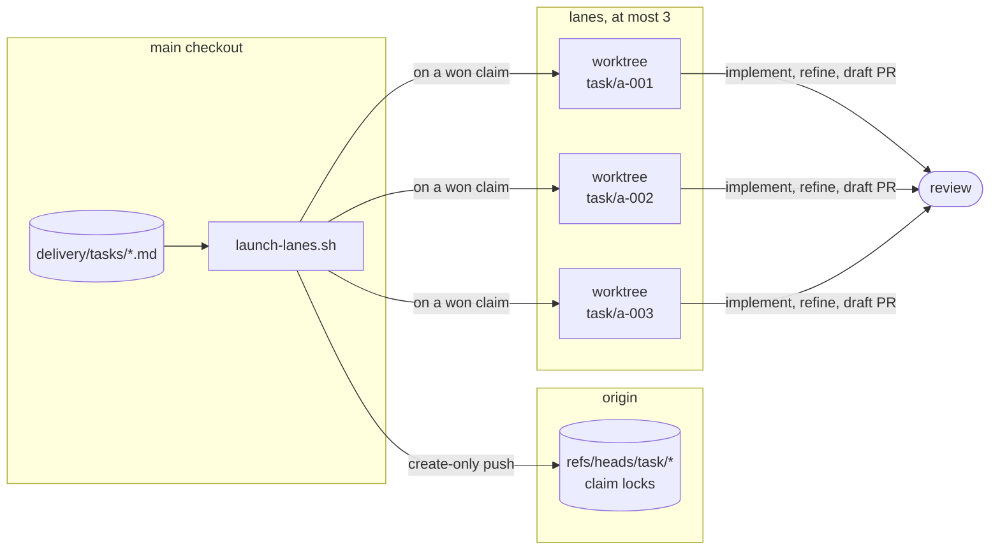

# Lanes

A **lane** is one task being built: its own git worktree, its own branch, two
agent sessions, and a draft pull request at the end.



## Claims

A claim is a create-only push of `task/<id>`: the first push wins, the loser is
told who holds it and picks another task. Nothing stores status; it is derived
from git refs and pull request state on every read.

The lane cap is three because three is roughly what one person can review, not
what the machine can run.

## Two sessions per lane

A lane is two sessions in its worktree: `etabli-implement` writes the change,
then `etabli-refine` reviews and tidies it on a stronger model. The launcher
then commits, pushes and opens the draft pull request. The lane's branch
pushes to itself, so a plain `git push` from the worktree reaches `task/<id>`
and never the default branch.

## Where worktrees go

Each lane's worktree goes in `../lanes/<repository>/<task-id>`, beside the
checkout the launcher runs from, where `<repository>` is that checkout's
directory name. The extra level matters because task ids repeat from one
project to the next: two repositories cloned side by side would otherwise both
put their `a-001` in `../lanes/a-001`. Nothing under `lanes/` is tracked by
git: each directory is a `git worktree` registered with its own clone, holding
that clone's task branch.

To put lanes somewhere else, set `DELIVERY_WORKTREE_ROOT` to a directory. It
replaces the whole default: task ids go directly under it, with no repository
level added, so give each project its own directory and never share one
between two projects. Where lanes live is each developer's choice rather than
the project's, so set it in your own environment for the planning repository,
not in a committed file. With mise, that is the untracked `mise.local.toml` at
the planning repository's root:

```toml
[env]
DELIVERY_WORKTREE_ROOT = "{{ env.HOME }}/lanes/shop"
```

Every launch then uses it: `a-001` runs in `~/lanes/shop/a-001`, whether you
start the launcher yourself, the follow loop starts it, or the orchestrator
does. `direnv` or an `export` in your shell work the same way. For a single
launch, `--worktree-root <dir>` takes precedence over the variable.

## Parallel or serial

Not every task set parallelizes. Two tasks editing the same file cannot be
merged independently however independent they look, and on an existing
codebase work converges on existing files far more often than new work does.
Expect a serial set there; it is the normal case, not a degraded one.

Decomposition finds this out and records it in the task files, so nobody has
to remember it at launch time:

- `conflicts_with` names the tasks one task must never run beside.
- `parallel: false` makes a task run alone: it starts only when nothing else of
  the set is in flight, on anyone's machine, and nothing starts while it runs.
  Use it for a lockfile change, a migration, or a rename across the
  repository, where the shared ground is too wide to list.
- A set that serializes marks every task `parallel: false`, and says
  **Run as:** serially in `delivery/decomposition.md`; the validator refuses
  the two disagreeing.

The launcher and the "what's next" answer both read those fields, so a serial
set runs one lane at a time with no flag to pass. Run the launcher again after
each merge to start the next task.

A serial set still goes through every phase and every gate: the requirements,
contracts and task files are what stop the work encoding guesses, whether or
not it runs concurrently. What changes is who needs the lanes. When one person
holds the whole set, skip the launcher and invoke `etabli-implement`, then
`etabli-refine`, per task in dependency order; the claim only earns its keep
when several people pick from the same tasks.
