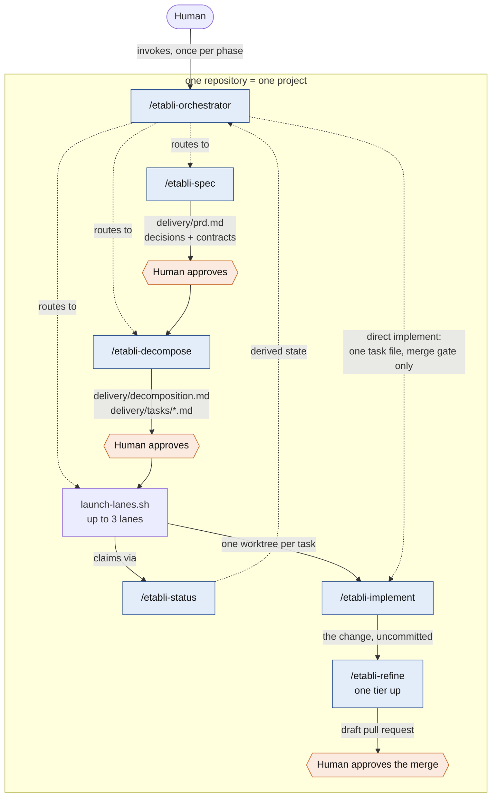

# The Route

## Projects, epics and tasks

A repository is one **project**: one team, one set of requirements.
Decomposition cuts it into **epics**, coherent slices one person can hold in
their head, and each epic into **tasks**, each one branch, one lane and one
pull request.

| Unit | Written as |
|---|---|
| Project | `delivery/prd.md`, with its decision records and `delivery/contracts/` |
| Milestone, optional | the Milestones section of `delivery/decomposition.md`, and a review note `delivery/milestones/<slug>.md` |
| Epic | a section of `delivery/decomposition.md` |
| Task | `delivery/tasks/<id>.md` |

Every artifact lives under `delivery/` at the repository root, so no agent has
to search for one. The definitions the agents apply are in the
[delivery conventions](https://github.com/ancelin-code/etabli/blob/main/.agents/skills/etabli-orchestrator/references/conventions.md#projects-epics-and-tasks).

## Phases and gates

Solid arrows are **artifacts**. Dotted arrows are **delegation**. Every phase
transition happens through a file, never through a live session, so a phase
can start in a fresh context and no long-running session has to carry state.

## Two ways through

The orchestrator investigates the request and the code before choosing how
much of the route to use:

| Path | When | What runs |
|---|---|---|
| Direct implement | One well-understood change with obvious acceptance criteria | one task file, then `etabli-implement` and `etabli-refine` in the ordinary checkout; no claim, no worktree, only the merge gate |
| Full route | Several tasks, contracts to keep parallel work consistent, or a decision worth recording | every phase and every gate, up to three lanes at once |

How much of a full route runs in parallel is decomposition's finding, not a
choice made up front; see [Parallel or serial](lanes.md#parallel-or-serial).

## Milestones

A project too large or too uncertain to cut at once is delivered in
**milestones**: ordered end-to-end slices, each with an exit criterion. The
requirements and the design stay whole. Only the current milestone is cut into
tasks, and once its tasks are merged a person reviews it in a short note:
whether the exit held, what was learned, and whether to continue or to revise
the requirements or a decision first. Approving the note lets the next
milestone be cut.

A project without milestones runs as one flat set.

## Requirement coverage

Requirements carry ids. Tasks name the requirement ids they cover, in full or
in part, so `etabli-status/scripts/coverage.sh` can say what is left of each
requirement.
