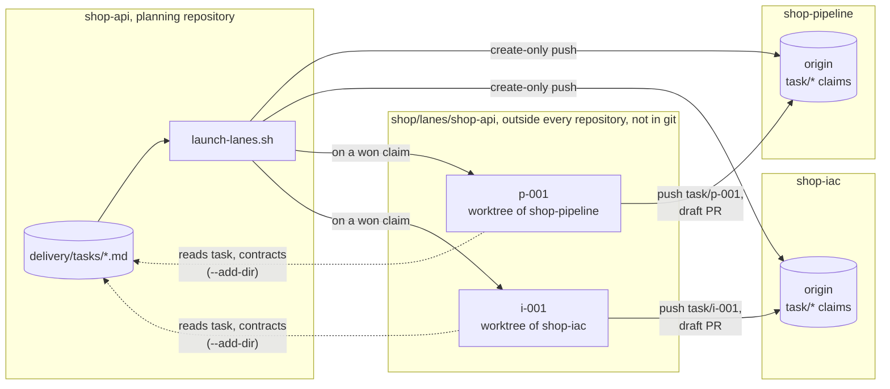

# Several Repositories

A project usually spans several repositories: infrastructure as code, a
service, a data pipeline, sometimes an API and a demo app. The kit plans it
**once, in one of them**, and lands each task in the repository its change
belongs to. Nothing is copied between repositories, so there's nothing to keep
in sync by hand.

## Lay the clones out side by side

Clone every repository of the project side by side, in one directory named
after the project, each clone named after its repository:

```text
shop/                         one directory per project
├── shop-api/                 planning repository: delivery/, and the kit
├── shop-pipeline/
├── shop-iac/
└── lanes/
    └── shop-api/             named after the planning repository, where the launcher runs
        ├── p-001/            worktree of shop-pipeline, branch task/p-001
        └── i-001/            worktree of shop-iac, branch task/i-001
```

`lanes/` sits beside the clones, not inside any of them, and holds one
directory per project, not one per repository: every worktree goes under the
planning repository's name, whichever repository it belongs to. What reaches
the forge is the lane's branch, pushed to its own repository.



The plan is read in one place, and every lane runs in one place; claims,
branches and pull requests happen in the repository each task changes.

## What lives where

- **The planning repository** holds `delivery/` (requirements, decisions,
  contracts, task files) and is the only one the kit is installed in. Pick the
  repository whose lifecycle is the project's, usually the main code
  repository. When three or more repositories share the work evenly, a small
  dedicated `<project>-hub` repository keeps any one of them from becoming
  special.
- **A task names where it lands** with `repo: shop-iac`, the directory name of
  the clone. Its claim, branch, worktree and pull request are all in that
  repository; its task file stays in the planning one. A task without `repo`
  lands in the planning repository, so a single-repository project changes
  nothing.
- **Dependencies cross repositories.** A task in the pipeline repository can
  wait for the API contract task to merge; `status.sh` reads every repository
  the task set names and derives state from each one's branches and pull
  requests.
- **Decisions** about the project live in the planning repository. A decision
  confined to one repository's internals lives in that repository's own
  record.
- **Contracts** are planned in `delivery/contracts/`. Once built, the
  repository that produces an interface owns its as-built form (an OpenAPI
  document, a schema, a published package), and consumers pin a version of it.
  This is how a service consumes a shared library: it pins a published
  version.

## Run everything from the planning repository

Run every kit command from the planning repository. The validator checks that
each `repo` has a clone beside it, so a missing clone fails at decomposition,
not hours later when a lane starts on someone else's machine. Each lane runs
in its target repository with read access to the planning repository
(`--add-dir`), where it finds its task file, the contracts and the decisions.

Every developer needs the same layout. A missing clone makes `status.sh` stop
and name it, rather than guess at the state of that repository's tasks.
